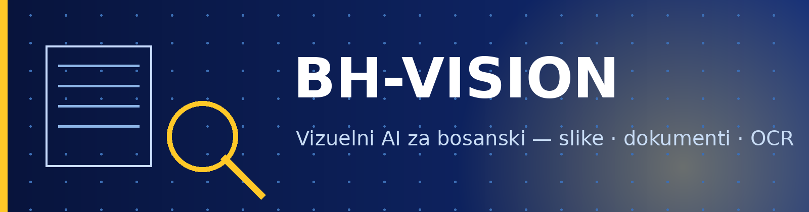

[](LICENSE)
[](pyproject.toml)
[](https://huggingface.co/collections/BH-Language-AI/bh-vision)
[](https://huggingface.co/BH-Language-AI/bh-vision-1-2b)
[](https://huggingface.co/datasets/BH-Language-AI/bs-vision-ocr-heldout-v01)
[](tests/)
[](https://github.com/BH-Language-AI/bh-vision/actions)

# 👁️ BH-Vision

**Vizuelni AI za bosanski jezik i Balkan — slike, dokumenti, OCR, chartovi, video.**
Prvi bosanski vision-language projekat: adaptacija otvorenih VLM-ova na bosanski — sa čćdžšđ, ijekavicom i domaćim dokumentima.

> 🎯 **Plan: prvo OK 2B verzija → pa 4B.** 2B je objavljen (v3, 46.1%); 4B je sljedeći (odabir baze u toku).

## 🏆 Benchmark — v03-val (217 uzoraka)

| Model | Ukupno | Chart (94) | Doc (123) | Status |
|---|---|---|---|---|
| Baseline (netreniran 2.2B) | 37.3% | — | — | referenca |
| v1 (frozen, 124 koraka) | 12.0% | — | — | ❌ memorizacija |
| v2 (odleđen, 62 koraka) | 0.0% | — | — | ❌ kolaps |
| **v3 ckpt-30** (frozen, lr 2e-5, 30 koraka) | **46.1%** | 24.5% | **62.6%** | ✅ **objavljen** |
| v5 (balanced, 91 korak) | 34.6% | 24.5% | 42.3% | odbijen |
| v7 (+113 pravih dokumenata) | 33.2% | 23.4% | 40.7% | odbijen |
| v9 (kratki, 40 koraka) | 46.5% | 24.5% | **63.4%** | validiran |
| v4 / v6 / v8 | 3–17% | — | 0–22% | ❌ kolapsi |

## 🧪 Held-out — pravi bhas dokumenti (73 QA)

| Model | Skor | Napomena |
|---|---|---|
| Baseline (netreniran 2.2B) | 21.9% | referenca na pravim dokumentima |
| **v3 ckpt-30** | **23.3%** | generalizira (slabije, ali stvarno) |
| v5 / v7 / v9 | 21–25% | u šumu — synth se slabo prenosi |

## ✅ Testovi

```bash
python3 -m pytest tests/ -q          # 2/2 passed (API stub + data contract)
python3 scripts/validate_data.py --data <jsonl> --images   # format + postojanje + PIL open svake slike
python3 scripts/qc_license.py        # gate: blokira trening na nečistim licencama
```

## 🗺️ Gdje je šta

| Šta | Gdje |
|---|---|
| 🤗 Modeli (2B ✅ težine, 8B/12B placeholderi) | [HF kolekcija BH-Vision](https://huggingface.co/collections/BH-Language-AI/bh-vision) |
| 📦 Trening setovi (synth3–10, plotqa-bs, bhas-bulk) | [HF dataseti](https://huggingface.co/datasets/BH-Language-AI/bs-vision-bhas-bulk-v01) + `data/manifest.yaml` |
| 🧪 Held-out (73 ručna QA, bhas 09/2026) | [bs-vision-ocr-heldout-v01](https://huggingface.co/datasets/BH-Language-AI/bs-vision-ocr-heldout-v01) |
| 📖 Odluke, registar, roadmap | [BH-LANGUAGE-AI](https://github.com/BH-Language-AI) (interni plan) |

## 🚀 Brzi start

```bash
pip install -e ".[train]"   # torch, transformers==5.22.2, trl, peft (pinovano!)
make doctor                 # suha provjera
python training/eval.py --base BH-Language-AI/bh-vision-1-2b --eval data/synth3/val.jsonl   # eval objavljenog
python scripts/fetch_plotqa_bs.py    # veliki setovi se vuku s HF-a (nisu u gitu)
```

> ⚠️ Trening troši GPU — samo uz odobrenje. Puni trag: [`docs/TRAINING.md`](docs/TRAINING.md) (v1–v10, svi brojevi).

## 📚 Dokumenti

- `docs/PROJECT_CHARTER.md` — misija, jezici (bs primarno, ijekavica), moduli
- `docs/ARCHITECTURE.md` — Arch A (adaptacija postojećeg VLM-a), vision adapter odvojen od tekstualnog frameworka
- `docs/MODELS.md` — kandidati s licencama (EU prioritet)
- `docs/DATASETS.md` — registar + praznine + vlastiti setovi
- `docs/TRAINING.md` — evidencija svih treninga (v1–v10)
- `slurm/` — LUMI job skripte (`dev-g`/`small-g`, MI250X, ROCm)
- `kaggle-*/` — Kaggle kerneli (smoke, trening, eval)

## 🧭 Ključne odluke

1. **Prvo OK 2B → pa 4B.** 2B gotov (SmolVLM2-2.2B + QLoRA, objavljen v3). 4B: odabir EU-čiste baze u toku (nema EU 4B checkpointa kao 2B — kandidati se provjeravaju).
2. Kratki treninzi pobjeđuju: 30–40 koraka 46% → 90+ koraka 33% → 140+ koraka ~4%. Zakon serije v1–v10.
3. Chart 24.5% je zid za ovaj pristup — treba veća rezolucija, full-finetune ili jača baza.
4. Bosanski OCR ne postoji javno — vlastiti sintetički + pravi bhas trening, held-out eval; proxy XM3600-hr + postocr-sr.
5. `transformers==5.22.2` pin — novije verzije lome SmolVLM2 merge; kontejnerski trl sjeni PYLIBS (poznato, zaobiđeno).

## 🤝 Kontakt

- E-mail: xnetba@gmail.com
- Organizacija: [BH-Language-AI](https://github.com/BH-Language-AI) (Kolektiv d.o.o. × Gamatrade d.o.o.)
- Pravila: vanjski resursi se referenciraju, ne kopiraju; objave težina/podataka samo uz odobrenje.
